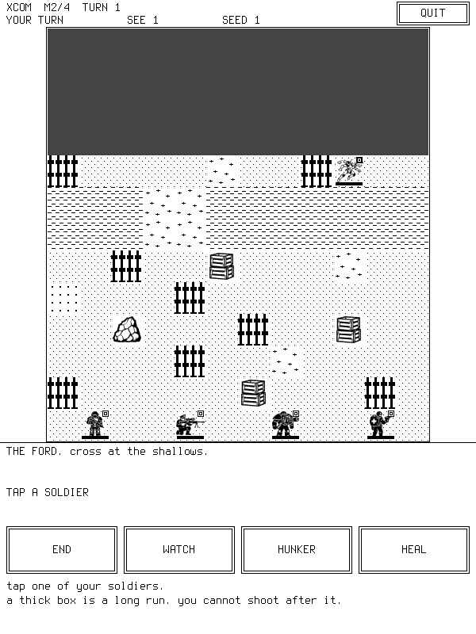
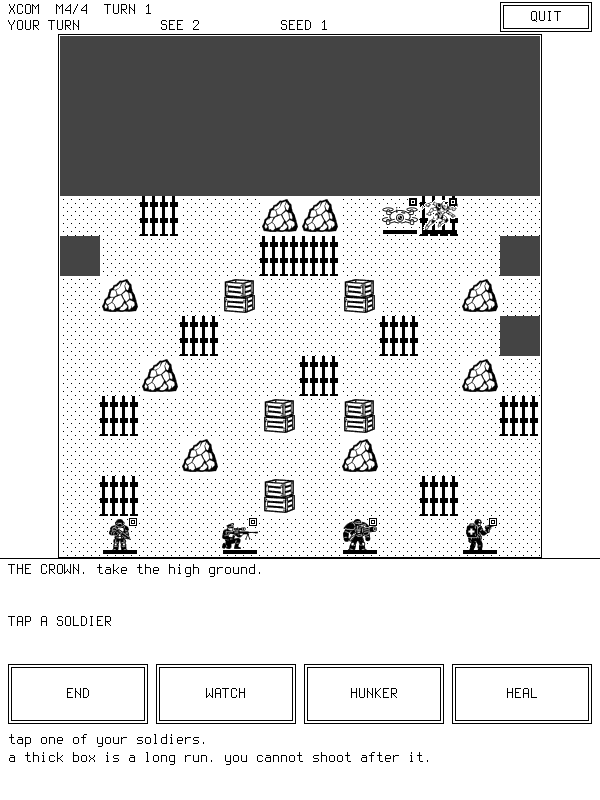

# Games on a Kindle

Four soldiers, aliens in the fog, one small e-ink screen. Tap to walk, tap an alien to shoot, wipe them out.
Chess against DeepSeek, which talks trash after every move. Tetris: tap to stack blocks and clear lines.
Sudoku: a generated puzzle with exactly one solution, three difficulties, hints, tap-to-play.
Rockman: dig dirt, grab diamonds, don't let the rocks fall on you.
Plants vs Pixels: five-lane plant defence — grow sunflowers, shoot peas, hold the lawn.
**Calib:** opens on two black squares that step together. The left one is the grey zap (it blinks). The right one is plain ink (it jumps). The time each zap took is printed underneath. That is the choice. NEXT opens the tuner. Screens run **RX → TUNER → GHOST → TAPLAG → CHESS**, NEXT on every one (the tuner's NEXT is a bar at the bottom left, above its two knob rows).
**SimCity port (in progress):** OpenSimCity/Micropolis core on the 600x800 e-ink panel.
**Brogue (in progress):** the classic roguelike from BrogueCE on the 600x800 e-ink panel — 100x34 text grid on the bottom 408 px, permanent 12-button bar on top, true 16-level grey (walls of darkness, lit glyphs) via the engine's grey layer.
**Peer link:** two Kindles talk to each other directly over ad-hoc wifi — no router, no internet. Games and messaging over the same link later.

---

## Quick Start

**What you need:** a jailbroken Kindle Touch with SSH on your network, this PC,
Docker image `kfb-build` (ARM cross-compiler), and `python3`.

```bash
make kindle                      # XCOM  -> ./xcom      (ARM binary)
make chess-kindle                # Chess -> ./chess     (needs chess.conf first)
make tetris-kindle               # Tetris -> ./tetris   (no key needed)
make sudoku-kindle               # Sudoku -> ./sudoku  (no key needed)
make rockman-kindle              # Rockman -> ./rockman (no key needed)
make pvz-kindle                   # PvZ -> ./pvz      (no key needed)
make brogue-kindle                # Brogue -> ./brogue-kindle-app
make calib                        # Calib tuner -> ./calib
make engine-test                  # PC check of the shared engine's full-refresh API
make wifi-test                    # wi-fi joining + the on-screen keyboard (PC only)
```

**Play Brogue or run the calib tuner on the Kindle** (same push-and-run pattern):

```bash
./run-brogue-on-kindle.sh [IP]    # roguelike. Taps do nothing yet; see "When it goes wrong" to give the screen back
./run-calib-on-kindle.sh [IP]     # perception tuner; tap QUIT to give the screen back
```

```bash
cp chess.conf.example chess.conf # chess only: paste your key, key = sk-...
```

**Play XCOM on the Kindle:**

```bash
./run-on-kindle.sh               # Kindle at 192.168.0.63 (KINDLE_IP in .kfb-secrets)
./run-on-kindle.sh 192.168.0.66  # second Kindle
```

**Prove two Kindles talk directly (no router):**

```bash
make echo-probe                    # tiny ARM TCP echo server
./run-peer-test.sh                 # A=192.168.0.63 B=192.168.0.66; or pass IPs
```

**Stop the Kindle falling asleep (fixed wifi/ssh dropouts while debugging):**

```bash
./tools/sleep-switch.sh on      # disable auto sleep (resets on reboot)
./tools/sleep-switch.sh off     # re-enable
./tools/sleep-switch.sh status  # confirm preventScreenSaver=1
```

It copies the game and its voice clips over, frees the touch screen, runs it, and
puts the Kindle back to normal when you quit. **Tap a soldier**, tap a boxed square
to walk, tap an alien then **FIRE**. **QUIT** then **SURE** exits; the game opens
**muted** — **UNMUTE** (left of QUIT) brings the voice back and **MUTE** silences
it again mid-sentence. The fight is a
**campaign of four boards** — the header counts M1/4 … M4/4, wiping a board out
advances you to the next one.

**Play chess on the Kindle:**

```bash
./run-chess-on-kindle.sh 192.168.0.63   # builds ./chess first, then pushes it
```

The script rebuilds `./chess` before it copies. A push of an old `./chess` looks
like nothing new. Confirm it landed:

```bash
K="-i ~/.ssh/kindle_touch_ed25519 -o BatchMode=yes -o IdentitiesOnly=yes -o StrictHostKeyChecking=no"
ssh $K root@192.168.0.63 'md5sum /mnt/us/chess /mnt/us/chess-wifi.sh; pidof chess'  # compare with `md5sum chess`
ssh $K root@192.168.0.63 'kill -USR1 <pid>'   # grab -> /tmp/chess-shot.pgm (15 grey levels = healthy)
```

On the glass the three bottom buttons are gone. The new
control is the small button at the **top right**: **QUIT** (tap twice),
**VOLUME**, **WIFI**, then **NEW**, **RETRY** and **TIMER**. Only chess has this menu.

The **TIMER** row in the menu sets a chess clock for the next game (tap to
cycle: off → 1 → 3 → 5 → 10 → 15 → 30 min, the same choices chess.com
offers). The choice is written back into
`chess.conf`, so it survives a reboot. The remaining time for both sides is
drawn at the top right of the board, the clock only runs while it is that
side's turn, and running out of time loses the game. The LLM is told the clock
state too, so it answers quickly when you are short of time.

Tapping a piece shows only a highlight ring: legal-move dots are deliberately
not drawn. A moved piece used to leave a faint ghost on its old square; the
engine now has `ek_full_refresh()`, which sends genuine `UPDATE_MODE_FULL` GC16
over just the tiles that changed. A move cleans **each of its two squares as a
separate box**, never one box spanning them: a full-mode update leaves a line
where it stops, and a spanning box drew that line through every square it
crossed. Each box also bleeds 3 px into the grid stroke, so the line lands
inside the board's own ink. `make engine-test` and `make chess-test` check that
contract on the PC (`--trace-refresh` prints the boxes) — host mode stubs the
panel ioctls, so the on-glass result still needs one look on a device.

**Play Tetris on the Kindle:**

```bash
./run-tetris-on-kindle.sh 192.168.0.66   # pass the IP
```

Tap **LEFT / TURN / RIGHT** to steer, **DROP** to slam it down, **QUIT** then **SURE** to exit.
Pieces fall on a fixed beat. The panel still has to repaint each step. A grey repaint blinks. A black-and-white repaint jumps. Calib shows both.

**Play it with the calibrated values** (speed 600, clean 30, WFM DU):

```bash
make tetris-kindle && ./run-tetris-on-kindle.sh <kindle-ip> --tuned --stats
```

`--tuned` is exactly `--speed 600 --clean-n 30 --wfm DU`. Each option works alone too.
On the Kindle this prints one line per update; the `us=` field is how many **ms** that
repaint really took.

**What the numbers say, measured on the device:** a DU repaint of a few 8x8 tiles costs
**~276–312 ms**, so **600 ms** leaves a real, even wait between drops. Earlier builds used
200 ms, which is *below what the panel can paint* — the game ran at ~300 ms whatever the
number said, and level 1 felt too fast. **320 ms is the hard floor**; asking for less is
refused with a message rather than quietly rounded up:

```
tetris: --speed 200 is under the panel floor of 320 ms (one DU repaint costs ~276-312 ms); pick 320 or more
```

Two more measured facts:

- **CLEAN 30 is worth keeping.** The GC16 clean frame costs ~631 ms (vs 276 ms for DU).
  That is a real swallow of the 320 ms beat every 30 drops — acceptable, since it clears
  the ghosting DU leaves.
- **DU ghosting needs a longer clean, not just a shorter one.** The `folded=12` /
  `folded=13` flushes in the log are the engine folding many dirty tiles into one rect;
  a DU-only game slowly leaves old outlines, so keep CLEAN 30 rather than 0.

**See the motion choice (calib):**

On this PC, the picture of the screen:

```bash
make calib-host
./calib-host --no-takeover --screen 4 --dump /tmp/calib-rx.pgm < /dev/null
python3 tools/pgm2png.py /tmp/calib-rx.pgm rx-layout.png   # open rx-layout.png
```

On the Kindle (tap the screen first so it is awake):

```bash
make calib
./run-calib-on-kindle.sh 192.168.0.66
```

Left square blinks (grey zap, GC16). Right square jumps (plain ink, DU). The milliseconds under each square are how long that zap took. **QUIT** gives the Kindle back. **NEXT** opens the tuner: SPEED, CLEAN, WFM (AUTO / DU / GC16F / GL16F / GC16), WAIT, MONO. Pick **DU** if the right square is the one you want. From the tuner, **NEXT** (the bar at the bottom left) goes on to the ghost-screen smear test, then the **chess pieces**, then the tap test — then back to RX.

The RX screen needs a **1-bit canvas** to force DU, and the chess-pieces screen needs the grey layer to draw its sprites. The grey layer cannot be turned off again, so once you have been to the chess screen RX is skipped for the rest of that run (it says so on stderr). Restart the app to get RX back.

**The chess pieces screen.** Same board and same baked sprites as the chess game, but no rules — tap a piece, tap a square, it moves. Chips: **SIZE** (piece size), **OFS X / OFS Y** (nudge the sprite off the square centre), **WFM** (waveform), **FULL** (redraw the two touched squares as one full-mode refresh instead of partials — the anti-ghost trick chess uses), **NEXT**. Turn **SIZE** down and the piece gets smaller than its square, which makes any centring error obvious.

**Getting there:** screens are `4 RX → 1 TUNER → 2 GHOST → 3 TAPLAG → 5 CHESS`. The **tuner** draws its own knob rows instead of the shared button strip, so its NEXT is a separate bar at the **bottom left**. (It had no NEXT at all before 2026-11-03, which made the chess screen unreachable — if you ever see a tuner with only two rows of knobs and no NEXT, that is the old build.) Jump straight to one screen with `--screen N`:

```bash
./calib-host --no-takeover --screen 5 --dump /tmp/calib-chess.pgm < /dev/null
python3 tools/pgm2png.py /tmp/calib-chess.pgm calib-chess-screen.png
```

**The motion ladder — consistent motion, in numbered steps.** The tuner's gate is
`GAP ≈ SPEED`: when the measured drop gap stays within ~60 ms of the speed you
asked for, the panel is really keeping that beat. The **VERDICT** line prints
`PANEL KEEPS THE BEAT` or `PANEL LAGGING` so you don't have to judge by eye.

1. **WFM → DU** (tap WFM, then `+` until the value row says DU). DU is the 1-bit
   motion waveform: one black push per step, no grey zap. A grey waveform's zap
   is a real time cost, not a poison — see step 3.
2. **SPEED → start at 600** (tetris level 1). 600 is measured: a DU repaint costs
   ~276–312 ms, so 600 leaves a real gap. Watch the VERDICT line. If it says
   LAGGING, raise SPEED by 50 until it says KEEPS THE BEAT. That number is your
   steady cadence — bake it into the game. Anything under **320** is refused,
   because the panel physically cannot paint a frame that fast.
3. **Grey is a trade, not a fix.** If the game needs real grey (XCOM art), the
   mid-step zap is unavoidable; the FLASH number on the tuner is how many ms each
   drop costs. Grey motion will *never* look metronome-even — that's physics, not
   a bug. Use DU for anything that moves and grey only for still art.
4. **CLEAN → 30, only if you see ghosting.** With DU, old-piece outlines can
   linger (ghosting). Set CLEAN to 30 (a GC16 clean every 30 drops) if you see
   trails; drop it to 20/10 if they persist. Start at 30 and only go lower when
   the smear test (NEXT, NEXT) shows a trail you actually see.
5. **WAIT stays ON.** WAIT OFF lets the engine queue updates — the GAP number
   becomes a lie and the panel collapses several steps into one big flash.
   "Consistent motion" means WAIT ON + GAP ≈ SPEED.
6. **Lock it in.** Go back to the game and force what the tuner chose. For
   tetris that is `ek_waveform(DU)` on the falling-piece flush (or trust AUTO,
   which already picks DU when nothing forces a grey mode).

**Play Sudoku on the Kindle:**

```bash
./run-sudoku-on-kindle.sh 192.168.0.66   # pass the IP
```

Tap a cell, then a digit **1–9** to write it. **ERASE** clears the cell, **HINT** writes the answer.
The three chips up top (**EASY / MED / HARD**) start a fresh puzzle; **NEW** restarts, **QUIT** then **SURE** exits.
A wrong digit gets a box, and a completed, conflict-free board is the win.
Pass `--seed N` to the runner to play the same puzzle again.

**Play Rockman on the Kindle:**

```bash
./run-rockman-on-kindle.sh 192.168.0.66   # pass the IP
```

**LEFT / UP / RIGHT / DOWN** dig and walk. **PUSH** shoves a rock sideways. Get all 8 diamonds and the exits open. **QUIT** then **SURE** exits.

**Play Plants vs Pixels on the Kindle:**

```bash
./run-pvz-on-kindle.sh 192.168.0.66   # pass the IP
```

Tap a seed card (Sunflower, Peashooter, Repeater, Snow Pea, Wall-nut, Tall-nut,
Cherry Bomb, Potato Mine), then tap a lawn square to plant it. Tap falling sun to
collect it — it is the only currency. Snow peas slow, cherry bombs and mines
blast a patch. Five zombies (fog, bucket) reach the house to win; lose five brains
and it is over. **QUIT** then **SURE** gives the screen back; tap the game-over
box to start a new lawn.

If the launcher menu is showing, the runner stops it first — the menu holds the
touch device — and hands the panel back to it when you quit, so this works from
the PC whatever is on screen. A run that never starts prints the runner's own
error (touch device refused, …) instead of claiming the game exited.

**Quitting always returns to the launcher menu, never Amazon's UI.** The runner
clears a stale `/mnt/us/.menu-stop` and starts the `menu` job on the way out, so
this holds even for a game started from the PC that never touched the menu. The
Amazon reader (which opens on its own store) comes back only if upstart refuses
the menu job — the last resort so the panel is never left dead. Both must never
run at once: the menu stops the mirror and keeps the Amazon UI hidden, pulling
the panel out from under a live reader.

To see what the Kindle is showing: `jailbreak-kindle/kindle-tools/fb-shot.sh
out.png` (it wants `KINDLE_IP`, e.g. `KINDLE_IP=192.168.0.66`), then read it as
text with `python3 tools/show_png_ascii.py out.png` — no image viewer needed.

**Boot straight into the launcher menu** (instead of the Amazon UI):

```bash
./install-menu-on-kindle.sh [IP]     # first time: build + push + boot job + show now
./run-menu-on-kindle.sh [IP]         # iterate: push fresh menu, show it now
```

`install-menu-on-kindle.sh` builds the menu + all five games, pushes them,
installs `/etc/upstart/menu.conf`
(replacing the old direct-to-chess boot job), and shows the menu now.
`run-menu-on-kindle.sh` is the iteration path: it frees the touch device of
any leftover game (waits for each to die, so a live game's binary is not
"Text file busy" to overwrite), pushes the full launcher set — `menu`,
`menu-boot.sh`, `grabtest`, every game binary + runner, the wifi helper,
`chess.conf` — and restarts the launcher session without touching the boot
job. Use it when a new button or a menu-boot.sh edit needs
to land on the device. Eight
buttons: **XCOM / CHESS / TETRIS / SUDOKU / ROCKMAN / KOREADER / WIFI / KINDLE**. Play a game; when you quit
you land back on the menu. **KOREADER** launches the KOReader reader
(`/mnt/us/koreader/koreader.sh`; when it exits, the launcher re-takes the
panel). **WIFI** reuses chess's wi-fi screens (join a
network, it remembers it). **KINDLE** hands the screen back to the Amazon
reader.

**The Amazon books app is already switched off.** The "books" UI is a Java/OSGi
framework (`/usr/java/bin/cvm`) started only by the upstart `framework` job;
the kernel never runs it. The marker file `/mnt/us/DONT_START_FRAMEWORK`
(created by the boot setup, shown by `./install-all-on-kindle.sh`) makes
`framework` skip `cvm` entirely, so the device boots straight into this menu
and `cvm` stays dead. See `.agent-kb/areas/reader-removal.md` for the full
boot chain and the options if you actually want to delete the book files
(not recommended — deleting jars on the read-only root buys nothing and a
firmware update repaints it).

**Fresh Kindle, everything at once** (jailbroken + ssh, then one run):

```bash
./install-all-on-kindle.sh [IP]       # builds + pushes every game, the menu boot
                                      # job, the screen-mirror job, fbdaemon,
                                      # chess key/CA, xcom sound, KOReader; starts
                                      # the menu. --no-build / --no-koreader to skip.
```

`install-menu-on-kindle.sh` only covers the menu + five games; the general
installer also brings xcom, pvz, calib, brogue, the fbdaemon set, both boot
jobs and KOReader — use it (or `run-menu`) to keep a rebuilt device in sync.

**Read books on the Kindle (KOReader):**

If the file browser crashes and reboots the Kindle: the crash leaves no
traceback (native kill; `ulimit -c` is hard 0 so no core), and the old launcher
erased its own log at every boot. Since the hardening, the crashed session is
preserved — after a crash look at `/mnt/us/menu-boot.log.prev` (last lines),
`/mnt/us/menu-heartbeat.prev` (gap = the hang window) and
`/mnt/us/koreader-launch.log` (has `[[koreader.sh exited rc=N]]` markers).

```bash
./install-koreader-on-kindle.sh [IP]   # pushes + unzips KOReader on /mnt/us
./run-koreader-on-kindle.sh [IP]       # run it now (no menu needed), exit to give the panel back
```

This installs KOReader from the staged
`jailbreak-kindle/kindle-tools/koreader-kindle-v2026.07.1.zip` (verified
md5) — the plain K4/Touch/PW1 build. It shows both in KUAL ("Start KOReader")
and as the menu's **KOREADER** button. No reboot needed; nothing is written
outside `/mnt/us`.

Changed `tools/menu-boot.sh` (button → game dispatch)? It is *copied* to
`/mnt/us/menu-boot.sh` on the Kindle — re-run `./install-menu-on-kindle.sh
[IP]` or `./run-menu-on-kindle.sh [IP]` (both push a fresh copy and restart
the session) or the new buttons keep hitting the old `case` arms. Undo (stock boot again):

```
ssh root@KINDLE_IP '/usr/sbin/mntroot rw; rm /etc/upstart/menu.conf; /usr/sbin/mntroot ro'
```

**No Kindle, no key — try it on this PC:**

```bash
make                                    # builds ./xcom-host
./xcom-host --seed 1 --dump /tmp/x.pgm  # draw the opening screen
make preview                            # every 40x40 sprite, side by side -> bold-preview.png
make test                               # plays a pretend game, checks pictures + clips
make tetris-host && make tetris-test    # self-test + three screens the checker reads
make sudoku-host && make sudoku-test    # self-test + three screens the checker reads
make rockman-host && make rockman-test  # self-test + title, room 1, and a short dig
make pvz-host && make pvz-test          # self-test + opening, planted, a wave
make menu-host && make menu-test        # menu: draw + tap every button on the PC
make brogue-host && make brogue-test    # Brogue: text-mode screens -> 600x800 preview frames + layout check
```

Both host programs take `tap X Y` lines on stdin and `--dump FILE` writes the
screen, so a bug is replayable: same `--seed`, same dice.

**SimCity screen mock (no Kindle or key needed):**

```bash
make poc                 # bakes classic Micropolis tiles -> poc/*.png
python3 -m http.server 8765 --directory poc
# open http://localhost:8765/view.html  (or see poc/screen_600x800_grey.png directly)
```

`poc/render_poc.py` draws the whole 600x800 e-ink frame: black header band with
paper-white text, a 20x21 grid of 30px tiles (classic tileset from
SimHacker/MicropolisCore), status strip, 8-tool toolbar, 1px grid lines.

Two rules baked into the file, both learned the hard way:

- **Ink polarity**: engine grey level 0 = paper (byte 255), level 15 = ink (0).
  Convert luma the other way round and text/header invert (invisible text, black
  "paper" band).
- **Per-tile-type tone targets, never a contrast stretch.** The classic palette is
  pastel and separates water/grass by *hue*, which greyscale throws away. Each tile
  type gets its own darkness band (`TONE` dict: grass light, water mid-dark, road
  near-black) and the tile's texture is remapped *into* that band; a nearly-flat
  tile fills one clean tone. Stretching each tile over the full band instead
  amplifies its noise into speckle — that first mock was unreadable (water speckle
  measured 11%, now ~1%).

---

## Brogue: how it fits together

A port of **BrogueCE** (`brogue/` — the Community Edition source tree) through
its swappable console backend (`struct brogueConsole`). The game core plots a
100x34 grid of 6x12 px glyph cells (600x408 px game window on the bottom), and
`brogue/src/platform/kfb-platform.c` renders it into the e-ink buffer; the
permanent 12-button control bar occupies the top 392 px (`kfb-bar.h`).
Text-mode only, no tileset — the classic Brogue legend (`#` wall, `.` floor,
`@` player, …). `make brogue-host` runs a scripted game and dumps 600x800 PGM
frames into `/tmp/kfb-frames` for the layout checker; `make brogue-kindle`
cross-compiles the static ARM binary `brogue-kindle-app`, and
`./run-brogue-on-kindle.sh [IP]` pushes + runs it. Touch mapping (two-tap
travel) and first on-device run are the next steps.

---

## XCOM: how it fits together

| File | What it is |
|---|---|
| `src/xcom.c` | the whole game: rules, drawing, touch, PC self-test |
| `src/audio.c` | the speaker: one child process owns `aplay`, the game never waits on it |
| `src/sprites.h` | 20 baked 40x40 tiles, generated — do not hand-edit |
| `tools/bake_bold_sprites.py` | bakes the tiles from `bold/` art plus the terrain patterns |
| `bold_sprite_sources.json` | which generated cell becomes which sprite |
| `bold/` | the generated art sheets (players, enemies, objects, drone) |
| `tools/make_sound.py` | bakes one `.pcm` per spoken word, plus the effects |
| `tools/check_sound.py` | reads the source and fails the build if a word has no clip |
| `sound/` | the baked clips, pushed to `/mnt/us/xcom-sound` |
| `tools/grabtest.c` | "is the touch device free right now?" probe |
| `MANUAL.md` | plain-prose game manual for TTS |

### The campaign: four boards

Four missions back to back, each with its own map, opening line and alien group —
all four live in `src/xcom.c` as the `M1`…`M4` literals, `MISSIONS[]` and
`ALIENS[][]`. The header counts `M1/4` … `M4/4`; clearing a board speaks its
log line and loads the next one; after M4 it prints `CAMPAIGN WON` and quits.
Losing the squad anywhere ends the run.

| # | spoken opening | board |
|---|---|---|
| 1 | FIRST CONTACT. wipe them out. | ruins, river, road |
| 2 | THE FORD. cross at the shallows. | forest, shallow ford |
| 3 | THE LONG ROAD. stay in cover. | long road, side cover |
| 4 | THE CROWN. take the high ground. | mountain ring, forest floor |

Terrain is the old char set plus `M` (mountains: block movement **and** sight,
no cover) and walkable `b` (bush: no cover). On the PC: `./xcom-host --mission 3`
opens any board, `--mission N --auto K --dump f.pgm` plays it out. `make test`
loads every board, proves all nine spawns are walkable and distinct, and speaks
every opening line; `tools/check_sound.py` now reads the `MISSIONS` table, so a
new spoken word fails the build until `tools/make_sound.py` bakes it (`make sound`).





### The panel shows real grey, so the art keeps its tone

The engine puts 16 greys on the panel and this game asks for them: startup calls
`ek_grey_enable()`, then every sprite, terrain square, fogged square and badge is
painted with `ek_grey_rect()`. Nothing is dithered, so a tone stored in
`sprites.h` is the tone you see — the speckle the old 1-bit build laid over every
square is gone. (No grey layer available? The engine says so and falls back to
the old 4x4 dither byte for byte, so the game never blanks.)

The baker keeps the art's tone all the way down: crop to the bounding box,
area-resize into <=36x34, flood the background out, centre. Only two decisions
are binary, and both are explicit:

- **The silhouette.** Transparency has no grey — a flood-fill from the border
  over the thresholded resize decides tile or background.
- **The ink guard.** A cell with no ink, or under 15% tone once fitted to 40x40,
  **aborts the bake** rather than shipping a blank tile. Nothing is substituted.

Team is read from the silhouette plus the badge the game draws over it, not from
black vs white. **Terrain is a pattern, not a picture**: dots = grass, trunks =
forest, waves = water, dashes = road, windows = city, pluses = rubble, peaks =
mountains.

To redo the art, drop four sheets into `bold/` — 13 cells total, no code changes:

| file | grid | cells, left-to-right top-to-bottom |
|---|---|---|
| `bold/players.png` | 2x2 | soldier, sniper, heavy, medic |
| `bold/enemies.png` | 2x2 | sectoid, sniper, mutant, assault |
| `bold/objects.png` | 2x2 | rocks, tree, crates, bush |
| `bold/drone.png` | 1x1 | drone |

Terrain (**grass / forest / city / road / water / rubble / mountains**) is **not** yours to
supply — those seven come from `PATTERNS` in the baker.

Rules the baker enforces, so the art has to be drawn to them:

- **512x512 per cell** (1024x1024 sheets), though any size that splits evenly into
  the grid works. Tiny cells are the risk: one that comes out empty dies with
  *"art vanished when scaled to 40 px"*.
- **Line art on white, grey welcome.** Tones are kept, not flattened — grey >= 120
  only decides the bounding box and the silhouette. The file is sniffed by content,
  not extension: WebP named `.png` is fine.
- **At least 15% tone** once the cell is fitted to 40x40, or the bake dies with
  *"<id> came out only 9% ink; too faint to read on e-ink"*. Nothing is substituted.
- **`"style"` and `"thicken"` are gone** from `bold_sprite_sources.json`: every cell
  bakes to a tone now, and the baker refuses a sheet that still carries them.

### Seeing every stage of the art at once

The baker runs these steps on the way down to 40x40, and only the last one is
what the panel shows. See all of them at once:

```bash
python3 tools/sprite_stages.py                 # -> sprite-stages.png
python3 tools/sprite_stages.py --only soldier  # one row
```

One row per sprite: source art, the box-resize into <=36x34, the silhouette
mask (the only thresholded thing in the pipeline), the stored 40x40 tone,
then the same tile on grass and on forest as the panel draws it, with the
paper rim, team badge and HP bar the game paints over it. The 40x40 beside
each name is true panel size; every other column is magnified 4x with
nearest-neighbour, no smoothing.

Column 4 and the two mock columns hold the same tone — no dither sits between
storage and screen — so if they ever disagree the renderer is what to suspect,
not the art. `tools/find_tile.py` is that check against a real dump: it reads a
tile out of `sprites.h` and searches the dumped greys byte for byte.

Then `make preview && make test`. Unit stats (HP, aim, damage) come from
`tactical_sprite_map_with_descriptions.json`, not the art, so new pictures change no rules.
Different filenames or grids mean editing `bold_sprite_sources.json` too.

The Kindle keeps the last binary you pushed, so new art needs **both** steps:

```bash
make kindle && ./run-on-kindle.sh 192.168.0.66
```

Check what is really on a rendered screen (a sprite in the header is not proof it
was drawn): `python3 tools/find_tile.py /tmp/xcom-open.pgm terrain_tiles/grass`,
`tools/dump_sprite.py player_units/soldier`, `tools/dump_region.py FILE X Y`.

The baker needs Pillow (`python3 -m pip install pillow`). That is a build-time
tool on this PC only; nothing extra ships to the Kindle.

`tools/slice_sprites.py` and `spritesheet.png` are the old dithered set, kept for
comparison only (`make preview-old`).

Sound is spliced from files, not generated on the device: `audio.c` turns a log
line into lower-case words, a number into "for four", and streams the matching
clips into `aplay`. A missing clip is reported by name, never swapped for
something else. No internet needed at runtime.

Painting uses the e-ink engine in
`jailbreak-kindle/kindle-tools/fbdaemon/engine`; that folder is shared and never
modified from here.

---

## Sudoku: how it fits together

One file, `src/sudoku.c`: the generator, the solver proof, drawing, touch and a PC self-test.
Every puzzle is **generated on the device** (seeded) and is proven to have exactly one
solution before it is shown: `solve_count() == 1` decides which cells may stay blank.
`make sudoku-test` checks rows/columns/boxes, unique solvability, error marking, hints and
wins on the PC, then draws three screens (open, one typed digit, a few auto hints) for the
picture checker. The menu's SUDOKU button and the boot dispatcher (`tools/menu-boot.sh`
case 4) launch the same runner as the other games.

---

## Tetris: how it fits together

One file, `src/tetris.c`: rules, drawing, the auto-player and a PC self-test. A falling
piece shows a ghost where it will land. `make tetris-test` runs the self-test plus three
screens (open, one tap, 24 auto pieces) and checks the well frame is drawn and the blocks
really stack.

---

## Rockman: how it fits together

One file, `src/rockman.c`. The caves, exits and 8x16 tiles come from
`src/rockman_data.h`, which `make rockman-data` rebuilds from `scratch/Rockman.asm`.
Do not edit that header by hand.

`make rockman-test` checks the rules, then writes three pictures:
`/tmp/rockman-title.pgm` (the title), `/tmp/rockman-room.pgm` (room 1),
`/tmp/rockman-play.pgm` (24 steps of digging).

On the Kindle: `make rockman-kindle`, then `./run-rockman-on-kindle.sh <ip>`.
The menu's ROCKMAN button is exit code 5; KOREADER is 6 (launches
`/mnt/us/koreader/koreader.sh`), WIFI is 7. No sound.

---

## Plants vs Pixels: how it fits together

One file, `src/pvz.c`: rules, drawing, touch and a PC self-test; sprites come
from `src/pvz_sprites.h`, baked by `tools/bake_pvz_sprites.py` from the
`pvz-art/` art. `make pvz-test` checks the rules (planting, sun cost, zombies
eating plants, brains, cherry bomb, waves) and then draws three screens for
the picture checker. On the Kindle: `make pvz-kindle`, then
`./run-pvz-on-kindle.sh <ip>`.

---

## Chess: how it fits together

Rules, board and the model call are all in `src/chess.c`. The Kindle talks to
`https://api.deepseek.com/v1/chat/completions` itself — nothing goes through this
PC. The push also drops this PC's CA bundle at `/mnt/us/chess-ca.pem`, because the
Kindle's own trust store is older than DeepSeek's certificate.

| File | What it is |
|---|---|
| `src/chess.c` | the whole game: rules, drawing, touch, wi-fi screen |
| `chess-art/*.png` | per-piece RGBA source art for the baked sprites |
| `tools/bake_chess_sprites.py` | bakes `chess-art/*.png` into `src/chess_pieces.h` |
| `src/chess_pieces.h` | generated piece tiles as 4-bpp nibbles (0 transparent, 1 paper, 2–15 ink) + `ch_at()` accessor (do not edit — run the baker) |
| `tools/chess-wifi.sh` | scan / join / remember, over `wpa_cli` |
| `tools/chess-boot.conf` | (superseded by `menu-boot.conf`) the old direct-to-chess boot job |
| `tools/menu-boot.conf` | upstart job that boots the Kindle into the launcher menu |
| `tools/menu-boot.sh` | the menu session: stop mirror, run menu, launch game, loop back |
| `tools/make_splash.py` | turns a PNG into the Kindle's 600x800 greyscale boot picture |
| `tools/kindle-run.sh` | on-device launcher: frees the screen, runs, restores |
| `chess.conf.example` | key, model, url, ca |

```bash
make chess-host
./chess-host --selftest --no-takeover             # rules, notation, perft
./chess-host --fake-ai --auto 8 --dump /tmp/c.pgm # both sides play, draw the board
./chess-host --apicheck --conf chess.conf         # ask the API one question
```

Check the screen of a game you cannot see (`kill -USR1 <pid of chess>` writes
`/tmp/chess-shot.pgm`). `--wifi-only` opens the wi-fi screens and exits without
a board (what the menu's WIFI button uses).

Where the piece art actually lands in its square:

```bash
python3 tools/chess_bg_replace.py /tmp/chess-shot.pgm out.png --board --zoom 2 --grid
python3 tools/chess_piece_offsets.py /tmp/chess-shot.pgm   # per-piece dx,dy table
python3 tools/chess_tile_offsets.py                        # centring inside the baked tile
python3 tools/chess_board_ascii.py /tmp/chess-shot.pgm     # terminal view, no viewer
```

`chess_bg_replace.py` rebuilds the board with the squares painted out (the
dark-square dither and borders are subtracted), so only the sprites remain and
`--grid` marks the true square centres with a cross. Each piece's ink is centred
on its square to **within 1 px** (worst bounding-box offset 1.0 px, measured on a
`--fake-ai --auto 8` dump); the `mass` column reads up to +5 px low because the
wide base of a piece carries most of the ink. That is the art, not a bug.

### Boot straight into the game

On the Kindle:

```
mntroot rw
cp /mnt/us/chess-boot.conf /etc/upstart/chess.conf
mntroot ro
```

Undo: `mntroot rw; rm /etc/upstart/chess.conf; mntroot ro`. It waits up to 3
minutes for Wi-Fi and starts anyway if it never comes up, because the game draws
its own Wi-Fi screen. One game per boot (`/tmp/chess.started`); after QUIT, start
it again over ssh or reboot. Progress is in `/mnt/us/chess-boot.log`.

### The launcher menu boot job

`tools/menu-boot.conf` (installed as `/etc/upstart/menu.conf`) is what makes the
Kindle boot into the menu. `tools/menu-boot.sh` is the always-on session: it
stops the screen mirror so the menu's touch grab wins, waits briefly for
wi-fi, runs the menu, launches the chosen game, and loops back when the game
exits. The menu itself is one file, `src/menu.c` (same e-ink engine as the
games). Progress is in `/mnt/us/menu-boot.log`.

### Wi-fi without the Kindle UI

The game draws its own screen: scan, tap a network, type the password on a drawn
keyboard, result saved to `/mnt/us/wifi.conf` so the next boot joins by itself.
Two symbol pages (12 keys) sit between the letters and the buttons, because real
passwords are full of `@ . - _ ! # $ %` and the letter rows cannot type them.
SHIFT is one capital then back to small, and says ON while it is armed.

```
sh /mnt/us/chess-wifi.sh status          # state / ssid / ip, exit 0 when online
sh /mnt/us/chess-wifi.sh join SSID PSK   # joins and remembers
sh /mnt/us/chess-wifi.sh auto            # rejoin what was remembered
```

Joining removes any older saved entry for that network name first: a stale
open-network entry for the same SSID makes `wpa_supplicant` refuse the join, which
on the glass looked like "connection failed" with the right password. If a join
does fail, the screen says which stage failed (password refused, or no such
network) instead of one general message.

Pictures of the screens: `wifi-keyboard.png` (letters), `wifi-keyboard-sym.png`
(symbol page, SHIFT on).

### Boot and device pictures

Every full-screen picture the Kindle shows is a 600x800 8-bit greyscale PNG
(colour type 0, no alpha) on the read-only root disk
(`/usr/sbin/mntroot rw` unlocks it). Five art screens are built from the
workspace's AI art:

```
python3 tools/make_boot_screens.py   # rebuilds all five into screens/
```

The AI art is dense ink (77–96% black), which would swallow the code-drawn
progress bar / labels, so each piece is inverted to a white panel with dark
etching (`tools/make_boot_screens.py` does this). The mapping:

| screen file | device paths it replaces |
|---|---|
| `screens/boot.png` | `/usr/share/blanket/bg_xsmall_defaultbg.png` **and** `/opt/amazon/low_level_screens/600x800/splash.png` (both must match; the `/var/local/blanket` link only points at the latter) |
| `screens/restart-low.png` | `/opt/amazon/low_level_screens/600x800/reboot.png` **and** `/var/local/blanket/low_level_screens/images/reboot.png` (the low-level renderer reads the `/var/local` copy — a real file, not a symlink) — the second restart screen ("rebooting") |
| `screens/restart-shutdown.png` | `/usr/share/blanket/shutdown/bg_xsmall_reboot.png` — the first restart screen (Settings → Restart dialog) |
| `screens/repair-update.png` | `/opt/amazon/low_level_screens/600x800/repair.png` (repair mode) — also a candidate for the `update_*.png` trio |
| `screens/misc.png` | any leftover: `critbatt`, `shipping_mode`, `cust_service`, langpicker, usb, ota |

The **screensaver slideshow** (sleep) is the same idea: 20 pictures on the
read-only root at `/usr/share/blanket/screensaver/bg_xsmall_ss00..19.png`,
each a 600x800 greyscale PNG. Unlike the boot screens, these are **not**
inverted — the dark art is shown as-is (nothing is painted over a
screensaver). Rebuild the whole set from the five newest art pieces (four
zoom/crop variants per piece so the slideshow varies):

```
python3 tools/make_screensaver_screens.py   # rebuilds screens/ss/ss00..ss19.png
mntroot rw
cp screens/ss/ss*.png /usr/share/blanket/screensaver/bg_xsmall_ssNN.png   # per-slot, on the kindle
mntroot ro
```

The stock `ss` pictures were overwritten in place (busybox `cp` has no `-n`,
so the backup copy silently failed); restore them from a firmware image if you
ever need the originals back. See `ss-preview.png` for a contact sheet of all 20.

Install any of them the same way (example: boot pair):

```
mntroot rw
cp screens/boot.png /usr/share/blanket/bg_xsmall_defaultbg.png
cp screens/boot.png /opt/amazon/low_level_screens/600x800/splash.png
mntroot ro
```

All five are now installed on the device — the Settings → Restart flow shows our
`restart-shutdown.png` (dialog) then `restart-low.png` (rebooting) before the
boot art. Every `bg_xsmall_defaultbg*` copy on the device — root, `splash/`,
`langpicker/`, and `ota/` — now carries our art (the `ota` one was the last
stock holdout; a blank white 600x800, backed up to
`/mnt/us/boot-splash-backup/ota/`). Their stock files are backed up at
`/mnt/us/boot-splash-backup/shutdown/` and `/mnt/us/boot-splash-backup/low-level/`.

Reboot to see the PNG swap. The bar along the bottom is drawn by code, so a
new picture still gets the bar. Stock PNG backups are at
`/mnt/us/boot-splash-backup/`. A firmware update puts those trees back.

The screen **before** that one is not one of these files. The kernel paints it
from a picture baked into the kernel, before Linux opens any PNG. Both kernel
copies on the raw disk carry it (main at `0x41000`, second at `0xE41000`);
gzip members at `0xC92C0` (plain logo, 2672 B) and `0xC9D30` (logo with
"Please wait a moment while your Kindle starts up." text, 4664 B), duplicated
at `0xEC7104` / `0xEC7B74`. Payload is a 12-byte LE header (`600,800,2`) plus
2-bit pixels at 4 px/byte (0=black, 3=white). Dense art never fits: even a
1-bit full screen is ~10 KB. The working render is the boot art
GaussianBlur(15), resized to 320x427, centred on pure black (the art's own
corners are black, so no border) — that gzips to 2470 bytes and fits the
plain slot, so one blob fits all four. The patch builds in
`scratch/patch_kernel_build.py` (stock blobs + old CRCs saved to
`scratch/kernel-logo-rollback.json`; output `scratch/mmcblk0-first32m-patched.bin`),
and `scratch/flash-kernel-logo.sh KINDLE_IP` verifies the device is still
stock, writes only the changed bytes, re-verifies, and does not auto-reboot.
The uImage data CRC (`dcrc` at +24) and header CRC (`hcrc` at +4) both have to
be recomputed, which the builder does.

To skip the boot POSTER entirely, take `splash` out of the two lines in `/etc/upstart/x.conf`.
Not tried yet. Do not `killall blanket` — the Kindle reboots into repair mode.
Games never stop the `x` job: stopping X makes restore-kindle.sh restart it on
exit, which makes blanket redraw the boot splash (the flicker after QUIT). They
take the screen with the engine's `EK_TAKEOVER` (framework + pillow only), and
the shared runner (`tools/kindle-run.sh`) stops powerd before each game so the
power key cannot raise the screen saver over the board — same clean start/stop
as XCOM for every game.

The PROGRESS BAR that keeps showing over the menu after boot is fixed properly:
it is blanket's `splash` module (the `x` job loads it, splash.conf walks it
0→90). Stock cleanup only runs from the disabled framework's
`framework_setup.conf` (`f_blanket_unload_module splash` +
`lipc-send-event -r 5 com.lab126.hal bootSplashCleanup`), and the engine's
takeover never touches blanket — so the menu used to draw its white frame
*under* the bar. `tools/clear-boot-splash.sh` repeats those two stock lipc
calls (raw, no `f_log` dependency), and `menu-boot.sh` runs it right before the
menu takes the panel. Verified live on .63: blanket modules go from
`langpicker usb screensaver splash` to `langpicker usb screensaver`, rc=0,
idempotent.

### Language strings (the "Kindle starts up" text)

The boot/restart screens' text comes from gettext catalogs on the read-only
root. The restart dialog's "Please wait a moment while your Kindle starts up."
is `shutdown.reboot.message` in `/usr/share/locale/en/LC_MESSAGES/blanket.mo`
(and `en_GB`). `tools/patch_blanket_mo.py` swaps one msgstr while keeping every
other byte of the file intact — a needed gift, because boot-time tools cannot
read NUL-free text if the pools grow:

```
python3 tools/patch_blanket_mo.py blanket.mo --msgid shutdown.reboot.message --to "Please wait a moment while your device starts up."
```

The patched `en` catalog is installed on the Kindle (backed up to
`/mnt/us/boot-splash-backup/locale/`); `en_GB` was left stock, and the change
shows on the restart dialog. It does not change the first screen. Those same
words are painted into the kernel picture, not read from this catalog.

---

## When it goes wrong

**Wi-fi says "connection failed" with the right password** — an older saved entry
for the same network name (an open-network one) makes the join fail. It is removed
before a new one is added now, so re-run `sh /mnt/us/chess-wifi.sh join SSID PSK`.
Both halves of this are tested on the PC: `make wifi-test` (the script against a
stand-in `wpa_cli`, and the real screens walked by taps).

**The Kindle still shows the old sprites** — the device is running the binary from
the last push. `make kindle`, then push again; rebuilding on this PC alone changes
nothing on the panel.

**`EVIOCGRAB refused: Resource busy`** — something still holds
`/dev/input/event3`. The launcher handles the usual culprits; if not, on the
Kindle: `initctl stop kfbterm; kill -9 $(pidof kfb)`. A leftover calibration
app (`calib`) is a third culprit — the runner kills it by name now, but a dead
session before that fix can leave it holding the panel: `kill $(pidof calib)`
and let it finish restoring.

**Screen draws but taps do nothing** — the screen mirror grabbed touch. A reboot
does not fix it (the mirror starts with the reader UI). `initctl stop kfbterm`.

**Screen stuck on the boot bar, taps do nothing** — the game menu was told to
stop and it turned the book reader back on while the game still held the
glass. The two fought, and the reader lost. Brogue does not read taps yet, so
QUIT on the glass does nothing. From this PC:

```
ssh root@192.168.0.63 'kill -9 $(pidof brogue-kindle-app menu); /sbin/initctl stop menu; rm -f /mnt/us/DONT_START_FRAMEWORK; /sbin/initctl start framework'
```

When `cvm` is running, press the power button once if the glass still looks blank.
The library should be there.

**Dead game and dead reader** (panel holding the last picture forever):

```
ssh root@KINDLE_IP 'pidof chess; /sbin/initctl status framework; pidof cvm'
ssh root@KINDLE_IP 'sh /mnt/us/fbdaemon/restore-kindle.sh'
```

Run the restore twice if `cvm` still does not appear. Kill the game first
(`kill $(pidof chess)`) or it keeps the panel.

**No sound** — the launcher says why before it starts. By hand:

```
amixer sget Speaker          # must read Playback [on]
```

A `sound: no clip words/x.pcm` line means the game said a word with no file: run
`make sound`, then push again. `make test` catches that before the device does.

---

## On this computer

```bash
make wifi-test                                   # wi-fi script + the tap-driven screens
./chess-host --wifi-shot /tmp/w.pgm pass         # draw the password screen
./chess-host --wifi-shot /tmp/w.pgm sym          # symbol page, SHIFT on
./xcom-host --selftest                           # check the rules
./xcom-host --mission 2 --seed 5 --dump /tmp/m2.pgm   # open board 2 of the campaign
./xcom-host --auto 2 --no-takeover               # let the computer play 2 turns
printf 'tap 120 536\n' | ./xcom-host --seed 1 --dump /tmp/picked.pgm
./xcom-host --soundcheck --auto 1                 # print the words it would say
```

No speaker on the PC: sound is off unless you ask for `--soundcheck`, which only
prints the words.
